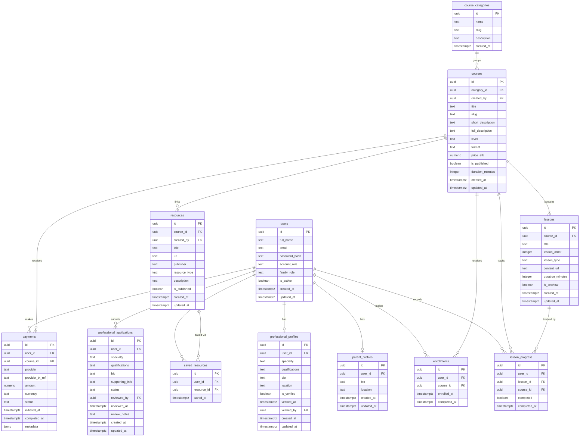

# Database Design — Sidra (ስድራ)

> This document defines the PostgreSQL relational database schema for the Sidra parenting education and family-support platform.
>
> **Status:** Design only. No tables have been created, no SQL has been executed, and no migrations exist yet.
> Review and approve this document before implementing the database.

---

## Table of Contents

1. [Architecture Overview](#architecture-overview)
2. [Key Design Decisions](#key-design-decisions)
3. [Table Definitions](#table-definitions)
   - [users](#1-users)
   - [parent_profiles](#2-parent_profiles)
   - [professional_profiles](#3-professional_profiles)
   - [professional_applications](#4-professional_applications)
   - [course_categories](#5-course_categories)
   - [courses](#6-courses)
   - [lessons](#7-lessons)
   - [enrollments](#8-enrollments)
   - [lesson_progress](#9-lesson_progress)
   - [resources](#10-resources)
   - [saved_resources](#11-saved_resources)
   - [payments](#12-payments)
4. [Relationships Summary](#relationships-summary)
5. [Entity-Relationship Diagram](#entity-relationship-diagram)
6. [Indexes](#indexes)
7. [Security Considerations](#security-considerations)
8. [Assumptions and Decisions Requiring Approval](#assumptions-and-decisions-requiring-approval)

---

## Architecture Overview

The database is a normalized PostgreSQL relational database. It supports:

- **User management** — accounts, authentication, account-level roles, and family roles
- **Learning** — categories, courses, lessons, enrollments, and progress tracking
- **Professionals** — profile directory and an admin-controlled application and approval workflow
- **Resources** — curated external learning materials with personal save lists
- **Payments** — transaction records structured for future integration with Chapa and Telebirr

### Role separation

Two distinct role systems exist and are stored separately:

| System | Values | Stored in |
|---|---|---|
| **Account role** | `admin`, `parent`, `professional` | `users.account_role` |
| **Family role** | `mother`, `father`, `legal_guardian`, `other_caregiver` | `users.family_role` |

Account role controls what a user can *do* on the platform.
Family role describes who the user *is* within their family.

---

## Key Design Decisions

1. **UUIDs as primary keys.** All tables use `UUID` primary keys generated by `gen_random_uuid()`. This avoids exposing sequential integer IDs in URLs and API responses, which would reveal platform size and allow enumeration attacks.

2. **`parent_profiles` and `professional_profiles` are separate tables** extending `users`, not columns on the `users` table. This keeps the core user table lean and makes profile queries focused.

3. **`professional_applications` is separate from `professional_profiles`.** An application is the submission workflow; a profile is the verified, public-facing result. They have different lifecycles and different data.

4. **Public registration cannot set `account_role = 'admin'`.** The backend will enforce that the `account_role` on all new registrations is either `parent` or `professional`. Admin accounts are created directly in the database or via a separate, protected internal process.

5. **Passwords are never stored.** Only the bcrypt hash is stored in `users.password_hash`. The plaintext password must never be logged, returned in an API response, or persisted anywhere.

6. **Duplicate enrollment prevention** is enforced at the database level with a `UNIQUE (user_id, course_id)` constraint on `enrollments`, in addition to any application-level check.

7. **Payment records store only transaction metadata.** No card numbers, PINs, account numbers, or raw credentials are ever stored. Only the provider's transaction reference ID, amount, currency, status, and provider name.

8. **`lesson_progress` records individual lesson completion**, not a percentage. Completion percentage is derived by counting completed lessons against total lessons — this avoids stale computed values.

9. **`resources` are platform-managed**, not user-generated. Only admins can create or edit resources. Users can save them to a personal list via `saved_resources`.

10. **Soft deletes are not used by default.** Records are hard-deleted unless there is a specific business reason to retain them (e.g. payment records, which should be retained for audit purposes). This simplifies queries and avoids accidentally exposing deleted data.

---

## Table Definitions

### 1. `users`

The central account table. Every person with an account has exactly one row here regardless of their role.

```sql
CREATE TABLE users (
  id              UUID          PRIMARY KEY DEFAULT gen_random_uuid(),
  full_name       TEXT          NOT NULL,
  email           TEXT          NOT NULL UNIQUE,
  password_hash   TEXT          NOT NULL,
  account_role    TEXT          NOT NULL DEFAULT 'parent'
                                CHECK (account_role IN ('admin', 'parent', 'professional')),
  family_role     TEXT          CHECK (family_role IN ('mother', 'father', 'legal_guardian', 'other_caregiver')),
  is_active       BOOLEAN       NOT NULL DEFAULT TRUE,
  created_at      TIMESTAMPTZ   NOT NULL DEFAULT NOW(),
  updated_at      TIMESTAMPTZ   NOT NULL DEFAULT NOW()
);
```

| Column | Notes |
|---|---|
| `id` | UUID primary key — safe to expose in URLs |
| `full_name` | Single name field; display name |
| `email` | Must be unique; lowercased before storage |
| `password_hash` | bcrypt hash only — never the plaintext password |
| `account_role` | Default `parent`; the backend must never allow `admin` via public registration |
| `family_role` | Optional at registration; nullable |
| `is_active` | `FALSE` = deactivated by admin; the user cannot log in |
| `created_at` / `updated_at` | `TIMESTAMPTZ` stores timezone-aware timestamps |

---

### 2. `parent_profiles`

Extended profile information for users with `account_role = 'parent'`. Optional — a parent can have an account without completing their profile.

```sql
CREATE TABLE parent_profiles (
  id              UUID          PRIMARY KEY DEFAULT gen_random_uuid(),
  user_id         UUID          NOT NULL UNIQUE REFERENCES users(id) ON DELETE CASCADE,
  bio             TEXT,
  location        TEXT,
  created_at      TIMESTAMPTZ   NOT NULL DEFAULT NOW(),
  updated_at      TIMESTAMPTZ   NOT NULL DEFAULT NOW()
);
```

| Column | Notes |
|---|---|
| `user_id` | `UNIQUE` — one profile per user; `CASCADE` delete with account |
| `bio` | Short optional self-description |
| `location` | City or region, optional; no precise address stored |

> **Privacy note:** No child-specific data (names, ages, medical details) is stored in this table. If child information is needed in future, a separate `children` table with appropriate consent controls should be designed at that time.

---

### 3. `professional_profiles`

The public-facing directory entry for a verified professional. Only exists for users with `account_role = 'professional'` who have been approved by an administrator.

```sql
CREATE TABLE professional_profiles (
  id                UUID        PRIMARY KEY DEFAULT gen_random_uuid(),
  user_id           UUID        NOT NULL UNIQUE REFERENCES users(id) ON DELETE CASCADE,
  specialty         TEXT        NOT NULL,
  qualifications    TEXT        NOT NULL,
  bio               TEXT        NOT NULL,
  location          TEXT,
  is_verified       BOOLEAN     NOT NULL DEFAULT FALSE,
  verified_at       TIMESTAMPTZ,
  verified_by       UUID        REFERENCES users(id) ON DELETE SET NULL,
  created_at        TIMESTAMPTZ NOT NULL DEFAULT NOW(),
  updated_at        TIMESTAMPTZ NOT NULL DEFAULT NOW()
);
```

| Column | Notes |
|---|---|
| `specialty` | e.g. "Developmental Paediatrician", "Speech-Language Pathologist" |
| `qualifications` | Free text describing credentials |
| `is_verified` | `FALSE` by default; set to `TRUE` by admin approval |
| `verified_at` | Timestamp of approval |
| `verified_by` | The admin user who approved; `SET NULL` if that admin is deleted |

> Only profiles with `is_verified = TRUE` should be returned by the public API.

---

### 4. `professional_applications`

Tracks the submission and review workflow for a professional requesting to join the directory. Separate from the profile itself — an application may be rejected, revised, and resubmitted.

```sql
CREATE TABLE professional_applications (
  id              UUID        PRIMARY KEY DEFAULT gen_random_uuid(),
  user_id         UUID        NOT NULL REFERENCES users(id) ON DELETE CASCADE,
  specialty       TEXT        NOT NULL,
  qualifications  TEXT        NOT NULL,
  bio             TEXT        NOT NULL,
  supporting_info TEXT,
  status          TEXT        NOT NULL DEFAULT 'pending'
                              CHECK (status IN ('pending', 'approved', 'rejected')),
  reviewed_by     UUID        REFERENCES users(id) ON DELETE SET NULL,
  reviewed_at     TIMESTAMPTZ,
  review_notes    TEXT,
  created_at      TIMESTAMPTZ NOT NULL DEFAULT NOW(),
  updated_at      TIMESTAMPTZ NOT NULL DEFAULT NOW()
);
```

| Column | Notes |
|---|---|
| `status` | `pending` → `approved` or `rejected` |
| `supporting_info` | Optional additional context provided by the applicant |
| `reviewed_by` | Admin who acted on the application |
| `review_notes` | Admin's internal notes — not exposed to the applicant |

> When an application is approved, the backend creates or updates the corresponding row in `professional_profiles` and sets `is_verified = TRUE`.

---

### 5. `course_categories`

Lookup table for course categories. Managed by administrators.

```sql
CREATE TABLE course_categories (
  id          UUID        PRIMARY KEY DEFAULT gen_random_uuid(),
  name        TEXT        NOT NULL UNIQUE,
  slug        TEXT        NOT NULL UNIQUE,
  description TEXT,
  created_at  TIMESTAMPTZ NOT NULL DEFAULT NOW()
);
```

| Column | Notes |
|---|---|
| `slug` | URL-safe identifier, e.g. `positive-parenting`; unique |

Seed values (matching the existing frontend):
- Parenting Fundamentals
- Child Development
- Positive Parenting
- Child Behavior & Emotional Development
- Special & Inclusive Needs
- Family Wellbeing
- Early Childhood Development

---

### 6. `courses`

Core course catalog. Courses belong to a category and are created by administrators.

```sql
CREATE TABLE courses (
  id              UUID        PRIMARY KEY DEFAULT gen_random_uuid(),
  category_id     UUID        NOT NULL REFERENCES course_categories(id) ON DELETE RESTRICT,
  created_by      UUID        REFERENCES users(id) ON DELETE SET NULL,
  title           TEXT        NOT NULL,
  slug            TEXT        NOT NULL UNIQUE,
  short_description TEXT      NOT NULL,
  full_description  TEXT      NOT NULL,
  level           TEXT        NOT NULL CHECK (level IN ('beginner', 'intermediate', 'advanced')),
  format          TEXT        NOT NULL CHECK (format IN ('video', 'reading', 'mixed', 'downloadable')),
  price_etb       NUMERIC(10, 2) NOT NULL DEFAULT 0.00 CHECK (price_etb >= 0),
  is_published    BOOLEAN     NOT NULL DEFAULT FALSE,
  duration_minutes INTEGER    CHECK (duration_minutes > 0),
  created_at      TIMESTAMPTZ NOT NULL DEFAULT NOW(),
  updated_at      TIMESTAMPTZ NOT NULL DEFAULT NOW()
);
```

| Column | Notes |
|---|---|
| `category_id` | `RESTRICT` delete — cannot delete a category that has courses |
| `created_by` | The admin who created it; `SET NULL` if that admin is deleted |
| `slug` | Unique URL identifier; e.g. `understanding-your-childs-development` |
| `price_etb` | Price in Ethiopian Birr; `0.00` = free |
| `is_published` | Only `TRUE` courses are visible to non-admin users |
| `duration_minutes` | Derived total — kept for display without querying lessons |

---

### 7. `lessons`

Individual lessons belonging to a course. Ordered within the course.

```sql
CREATE TABLE lessons (
  id              UUID        PRIMARY KEY DEFAULT gen_random_uuid(),
  course_id       UUID        NOT NULL REFERENCES courses(id) ON DELETE CASCADE,
  title           TEXT        NOT NULL,
  lesson_order    INTEGER     NOT NULL CHECK (lesson_order > 0),
  lesson_type     TEXT        NOT NULL CHECK (lesson_type IN ('video', 'reading', 'downloadable')),
  content_url     TEXT,
  duration_minutes INTEGER    CHECK (duration_minutes > 0),
  is_preview      BOOLEAN     NOT NULL DEFAULT FALSE,
  created_at      TIMESTAMPTZ NOT NULL DEFAULT NOW(),
  updated_at      TIMESTAMPTZ NOT NULL DEFAULT NOW(),
  UNIQUE (course_id, lesson_order)
);
```

| Column | Notes |
|---|---|
| `lesson_order` | 1-based position within the course |
| `content_url` | URL to video, PDF, or reading material |
| `is_preview` | `TRUE` = accessible without enrollment |
| `UNIQUE (course_id, lesson_order)` | Prevents two lessons having the same position in a course |

---

### 8. `enrollments`

Records a user's enrollment in a course. A user can only enroll in a given course once.

```sql
CREATE TABLE enrollments (
  id              UUID        PRIMARY KEY DEFAULT gen_random_uuid(),
  user_id         UUID        NOT NULL REFERENCES users(id) ON DELETE CASCADE,
  course_id       UUID        NOT NULL REFERENCES courses(id) ON DELETE CASCADE,
  enrolled_at     TIMESTAMPTZ NOT NULL DEFAULT NOW(),
  completed_at    TIMESTAMPTZ,
  UNIQUE (user_id, course_id)
);
```

| Column | Notes |
|---|---|
| `UNIQUE (user_id, course_id)` | Database-level enforcement of no duplicate enrollments |
| `completed_at` | Set when all lessons are marked complete; `NULL` = in progress |

---

### 9. `lesson_progress`

Tracks whether a specific user has completed a specific lesson. One row per user per lesson.

```sql
CREATE TABLE lesson_progress (
  id              UUID        PRIMARY KEY DEFAULT gen_random_uuid(),
  user_id         UUID        NOT NULL REFERENCES users(id) ON DELETE CASCADE,
  lesson_id       UUID        NOT NULL REFERENCES lessons(id) ON DELETE CASCADE,
  course_id       UUID        NOT NULL REFERENCES courses(id) ON DELETE CASCADE,
  completed       BOOLEAN     NOT NULL DEFAULT FALSE,
  completed_at    TIMESTAMPTZ,
  UNIQUE (user_id, lesson_id)
);
```

| Column | Notes |
|---|---|
| `course_id` | Denormalized for efficient progress queries without a join to `lessons` |
| `UNIQUE (user_id, lesson_id)` | Prevents duplicate progress records |
| `completed_at` | `NULL` until the lesson is marked complete |

> Completion percentage is computed at query time: `COUNT(*) FILTER (WHERE completed) / total_lessons`.

---

### 10. `resources`

Platform-curated external learning resources. Created and managed by administrators only.

```sql
CREATE TABLE resources (
  id              UUID        PRIMARY KEY DEFAULT gen_random_uuid(),
  course_id       UUID        REFERENCES courses(id) ON DELETE SET NULL,
  created_by      UUID        REFERENCES users(id) ON DELETE SET NULL,
  title           TEXT        NOT NULL,
  url             TEXT        NOT NULL,
  publisher       TEXT,
  resource_type   TEXT        NOT NULL CHECK (resource_type IN ('article', 'guide', 'video', 'tool', 'downloadable')),
  description     TEXT,
  is_published    BOOLEAN     NOT NULL DEFAULT TRUE,
  created_at      TIMESTAMPTZ NOT NULL DEFAULT NOW(),
  updated_at      TIMESTAMPTZ NOT NULL DEFAULT NOW()
);
```

| Column | Notes |
|---|---|
| `course_id` | Optional — a resource may be linked to a course or be a standalone resource |
| `url` | External URL; validated by the application layer |
| `publisher` | Organisation or source name, e.g. "WHO", "UNICEF", "CDC" |
| `resource_type` | Constrained to known types |

---

### 11. `saved_resources`

A user's personal saved-resource list. A user can save a resource only once.

```sql
CREATE TABLE saved_resources (
  id              UUID        PRIMARY KEY DEFAULT gen_random_uuid(),
  user_id         UUID        NOT NULL REFERENCES users(id) ON DELETE CASCADE,
  resource_id     UUID        NOT NULL REFERENCES resources(id) ON DELETE CASCADE,
  saved_at        TIMESTAMPTZ NOT NULL DEFAULT NOW(),
  UNIQUE (user_id, resource_id)
);
```

| Column | Notes |
|---|---|
| `UNIQUE (user_id, resource_id)` | Prevents duplicates in the save list |

---

### 12. `payments`

Records payment transactions for paid course enrollments. Designed for future integration with Chapa and Telebirr. No sensitive payment credentials are ever stored here.

```sql
CREATE TABLE payments (
  id                  UUID          PRIMARY KEY DEFAULT gen_random_uuid(),
  user_id             UUID          NOT NULL REFERENCES users(id) ON DELETE RESTRICT,
  course_id           UUID          NOT NULL REFERENCES courses(id) ON DELETE RESTRICT,
  provider            TEXT          NOT NULL CHECK (provider IN ('chapa', 'telebirr', 'other')),
  provider_tx_ref     TEXT          NOT NULL UNIQUE,
  amount              NUMERIC(10,2) NOT NULL CHECK (amount > 0),
  currency            TEXT          NOT NULL DEFAULT 'ETB',
  status              TEXT          NOT NULL DEFAULT 'pending'
                                    CHECK (status IN ('pending', 'completed', 'failed', 'refunded')),
  initiated_at        TIMESTAMPTZ   NOT NULL DEFAULT NOW(),
  completed_at        TIMESTAMPTZ,
  metadata            JSONB
);
```

| Column | Notes |
|---|---|
| `user_id` | `RESTRICT` delete — payment records are retained even if the user account is deactivated |
| `course_id` | `RESTRICT` delete — payment records are retained even if a course is removed |
| `provider` | Payment provider name; extensible via a future lookup table |
| `provider_tx_ref` | The unique transaction reference returned by the payment provider; `UNIQUE` prevents duplicate records |
| `amount` | The amount charged; stored separately from the course price to preserve historical accuracy |
| `currency` | Defaults to `ETB` (Ethiopian Birr) |
| `status` | Lifecycle: `pending` → `completed` or `failed`; `refunded` for reversals |
| `metadata` | Optional JSONB for provider-specific response data — never contains card numbers or credentials |

> **Important:** The backend must verify payment status by calling the provider's verification API. Enrollment must only be granted after `status = 'completed'` is confirmed from the provider — never from a frontend-only callback.

---

## Relationships Summary

```
users ──────────────── parent_profiles          (1 user → 0 or 1 parent profile)
users ──────────────── professional_profiles    (1 user → 0 or 1 professional profile)
users ──────────────── professional_applications (1 user → 0 or many applications)
users ──────────────── enrollments              (1 user → 0 or many enrollments)
users ──────────────── lesson_progress          (1 user → 0 or many progress records)
users ──────────────── saved_resources          (1 user → 0 or many saved resources)
users ──────────────── payments                 (1 user → 0 or many payments)

course_categories ───── courses                 (1 category → 0 or many courses)
courses ─────────────── lessons                 (1 course → 1 or many lessons)
courses ─────────────── enrollments             (1 course → 0 or many enrollments)
courses ─────────────── lesson_progress         (1 course → 0 or many progress records)
courses ─────────────── resources               (1 course → 0 or many resources)
courses ─────────────── payments                (1 course → 0 or many payments)

lessons ─────────────── lesson_progress         (1 lesson → 0 or many progress records)
resources ───────────── saved_resources         (1 resource → 0 or many saves)
```

---

## Entity-Relationship Diagram



---

## Indexes

Beyond the primary keys and `UNIQUE` constraints already defined, the following indexes should be created to support common query patterns:

```sql
-- User lookups
CREATE INDEX idx_users_email         ON users (email);
CREATE INDEX idx_users_account_role  ON users (account_role);

-- Course catalog browsing
CREATE INDEX idx_courses_category    ON courses (category_id);
CREATE INDEX idx_courses_published   ON courses (is_published);
CREATE INDEX idx_courses_slug        ON courses (slug);

-- Lesson ordering within a course
CREATE INDEX idx_lessons_course_order ON lessons (course_id, lesson_order);

-- Enrollment lookups
CREATE INDEX idx_enrollments_user    ON enrollments (user_id);
CREATE INDEX idx_enrollments_course  ON enrollments (course_id);

-- Progress queries (e.g. "show all progress for a user in a course")
CREATE INDEX idx_lesson_progress_user_course ON lesson_progress (user_id, course_id);

-- Payment lookups
CREATE INDEX idx_payments_user       ON payments (user_id);
CREATE INDEX idx_payments_status     ON payments (status);
CREATE INDEX idx_payments_tx_ref     ON payments (provider_tx_ref);

-- Professional directory
CREATE INDEX idx_professional_profiles_verified ON professional_profiles (is_verified);

-- Professional applications
CREATE INDEX idx_prof_applications_user   ON professional_applications (user_id);
CREATE INDEX idx_prof_applications_status ON professional_applications (status);

-- Resources
CREATE INDEX idx_resources_course    ON resources (course_id);

-- Saved resources
CREATE INDEX idx_saved_resources_user ON saved_resources (user_id);
```

---

## Security Considerations

### Password storage
Passwords are stored only as bcrypt hashes in `users.password_hash`. The plaintext password must never be logged, returned in an API response, or persisted anywhere in the system.

### Role assignment
The backend API for public registration must hard-code `account_role = 'parent'`. The value must never be accepted from the request body for public registration endpoints. Admin accounts must be created through a separate, access-controlled process.

### Row-level data access
The API layer must enforce that:
- A user can only read their own `lesson_progress`, `enrollments`, `saved_resources`, and `payments`.
- Only verified professional profiles (`is_verified = TRUE`) are returned by public API endpoints.
- Admin-only fields (e.g. `review_notes`, `password_hash`) are never included in API responses to non-admin users.

### Payment records
The `payments` table stores only transaction metadata — provider name, transaction reference, amount, currency, and status. Raw card numbers, PINs, mobile wallet credentials, or any other sensitive payment credentials must never be stored. The `metadata` JSONB column may hold provider response payloads but must be reviewed to ensure no sensitive data leaks into it.

Payment status must be verified by the backend calling the payment provider's verification endpoint. Enrollment must only be granted after `status = 'completed'` is confirmed server-side.

### Cascades and retention
Payment records use `ON DELETE RESTRICT` for both `user_id` and `course_id` because financial records should be retained even if a user is deactivated or a course is removed. Deactivation of a user (`is_active = FALSE`) is preferred over deletion for accounts with payment history.

### Timestamps
All timestamps use `TIMESTAMPTZ` (timezone-aware) to avoid ambiguity across timezones. The database server should be configured to use UTC.

---

## Assumptions and Decisions Requiring Approval

The following decisions were made during design. Please review each one and confirm or request a change before implementation begins.

| # | Decision | Rationale | Action needed |
|---|---|---|---|
| 1 | **UUIDs** as primary keys throughout | Prevents ID enumeration; safe to expose in URLs | Confirm or request integer IDs |
| 2 | **`family_role` is nullable** on `users` | Users may register without selecting a family role; it can be set later | Confirm or require it at registration |
| 3 | **`professional` is an account role** in addition to being in the directory | Allows a professional to have an authenticated account and submit applications | Confirm this dual-role model |
| 4 | **No `modules` table** in the schema | The frontend uses modules as UI groupings only; lessons are ordered with `lesson_order` | Confirm, or request a `modules` table if course modules need to be persistent and database-driven |
| 5 | **No child data table** | No names, ages, or medical details about children are stored | Confirm, or specify what child data (if any) needs to be stored |
| 6 | **`payments` uses `RESTRICT` delete** for users and courses | Financial records are retained for audit even after account deactivation or course removal | Confirm this retention approach |
| 7 | **`resources` are admin-only creations** | Users can save resources but not create them | Confirm, or specify if professionals or parents should be able to suggest resources |
| 8 | **Single `professional_applications` table** per user (multiple rows allowed) | A professional can reapply after rejection | Confirm, or restrict to one application per user at a time |
| 9 | **Payment `provider` is a constrained text field** (`chapa`, `telebirr`, `other`) | Keeps it simple; extensible to a lookup table later | Confirm, or request a `payment_providers` table now |
| 10 | **No soft deletes** except where noted | Simpler queries; hard deletes preferred | Confirm, or specify which tables need soft delete (`deleted_at` column) |
