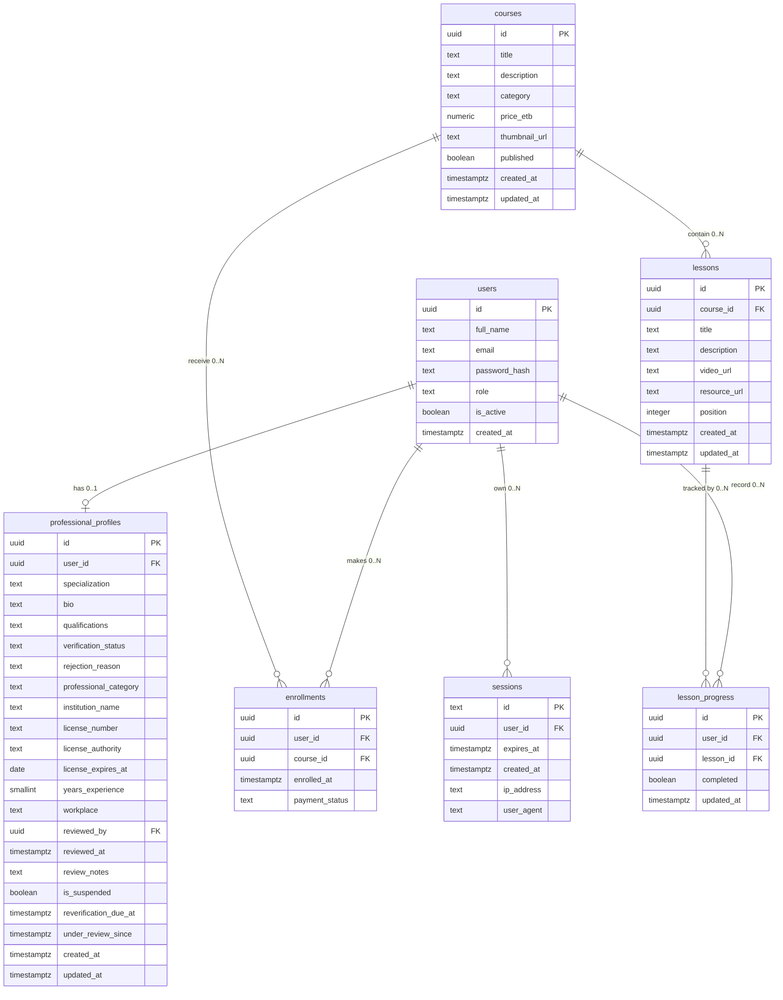
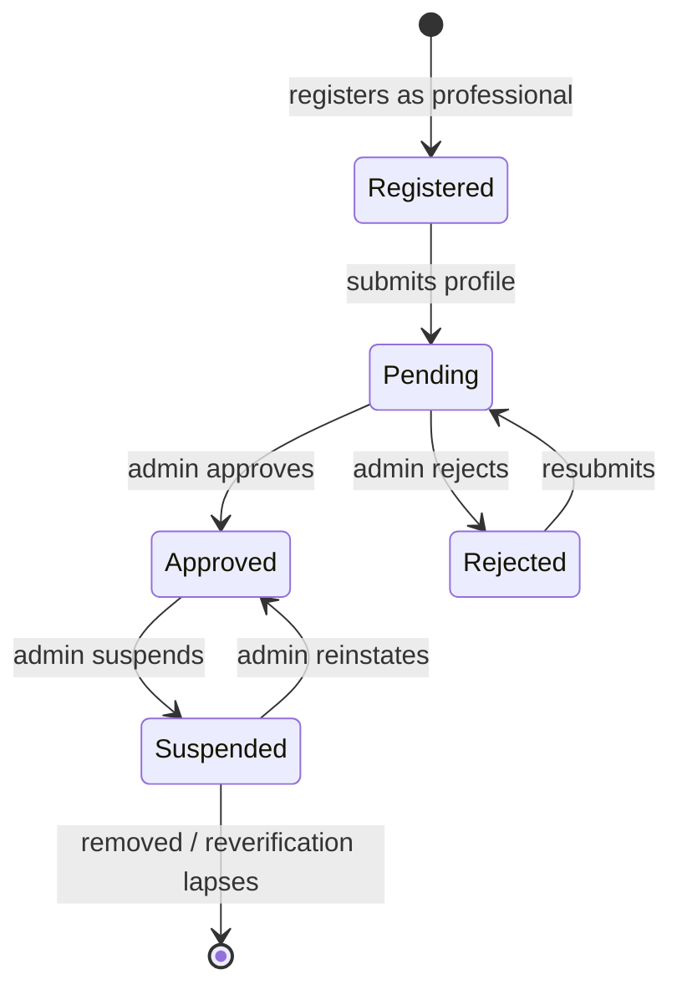

# Database Design — Sidra (ስድራ)

> This document describes the implemented PostgreSQL schema for the Sidra parenting education and family-support platform. It reflects the SQL in [`server/src/db/schema.sql`](../server/src/db/schema.sql) and the migration runner in [`server/src/db/migrate.js`](../server/src/db/migrate.js).

---

## Table of Contents

1. [Overview](#overview)
2. [Entity-Relationship Diagram](#entity-relationship-diagram)
3. [Tables](#tables)
   - [1. `users`](#1-users)
   - [2. `professional_profiles`](#2-professional_profiles)
   - [3. `courses`](#3-courses)
   - [4. `lessons`](#4-lessons)
   - [5. `enrollments`](#5-enrollments)
   - [6. `lesson_progress`](#6-lesson_progress)
   - [7. `sessions`](#7-sessions)
4. [Migration 2025-01 — rejection reason](#migration-2025-01--rejection-reason)
5. [Migration 2025-02 — extended professional profiles](#migration-2025-02--extended-professional-profiles)
6. [Role Model](#role-model)
7. [Security Notes](#security-notes)
8. [Migration Strategy](#migration-strategy)

---

## Overview

Sidra is a **PERN-stack** application: **P**ostgreSQL, **E**xpress, **R**eact, **N**ode. The data layer is a normalized PostgreSQL relational database accessed from the Node/Express backend via the `pg` driver.

The schema currently defines **7 tables**:

| # | Table | Purpose |
|---|---|---|
| 1 | `users` | Central account table — one row per person |
| 2 | `professional_profiles` | Extended profile for professional users; gated by admin verification |
| 3 | `courses` | Course catalog |
| 4 | `lessons` | Individual lessons within a course |
| 5 | `enrollments` | A user's enrollment in a course |
| 6 | `lesson_progress` | Per-lesson completion tracking |
| 7 | `sessions` | Server-side session store for cookie auth |

Two **idempotent migrations** are appended to the base schema and applied in order:

- **2025-01** — adds `rejection_reason` to `professional_profiles`
- **2025-02** — extends `professional_profiles` with richer credential fields, a verification workflow, and suspension/reverification support

The entire schema is **idempotent**. Every DDL statement uses `CREATE TABLE IF NOT EXISTS` or `ADD COLUMN IF NOT EXISTS`, so the same file can be re-run safely any number of times. Existing tables and data are never dropped or overwritten. This makes migrations additive and safe for development, staging, and production without a separate down-migration.

---

## Entity-Relationship Diagram



Relationship cardinalities, as enforced by foreign keys:

- `users` (1) ←→ (0..1) `professional_profiles` — `professional_profiles.user_id` is `UNIQUE`
- `users` (1) ←→ (0..N) `enrollments`
- `courses` (1) ←→ (0..N) `enrollments`
- `courses` (1) ←→ (0..N) `lessons`
- `users` (1) ←→ (0..N) `lesson_progress`
- `lessons` (1) ←→ (0..N) `lesson_progress`
- `users` (1) ←→ (0..N) `sessions`

---

## Tables

### 1. `users`

The central account table. Every person on the platform has exactly one row here regardless of their role. Roles (`mother`, `father`, `legal_guardian`, `professional`, `admin`) are all stored in the single `role` column.

```sql
CREATE TABLE IF NOT EXISTS users (
    id            UUID          PRIMARY KEY DEFAULT gen_random_uuid(),
    full_name     TEXT          NOT NULL CHECK (char_length(trim(full_name)) >= 2),
    email         TEXT          NOT NULL UNIQUE,
    password_hash TEXT          NOT NULL,
    role          TEXT          NOT NULL DEFAULT 'mother'
                                CHECK (role IN ('mother', 'father', 'legal_guardian', 'professional', 'admin')),
    is_active     BOOLEAN       NOT NULL DEFAULT TRUE,
    created_at    TIMESTAMPTZ   NOT NULL DEFAULT NOW()
);
```

| Column | Type | Constraints | Description |
|---|---|---|---|
| `id` | `UUID` | `PRIMARY KEY`, default `gen_random_uuid()` | Surrogate key, safe to expose in URLs |
| `full_name` | `TEXT` | `NOT NULL`, `CHECK (char_length(trim(full_name)) >= 2)` | Display name; must be at least 2 non-whitespace characters |
| `email` | `TEXT` | `NOT NULL UNIQUE` | Login identifier; unique across the platform |
| `password_hash` | `TEXT` | `NOT NULL` | bcrypt hash only — never the plaintext password |
| `role` | `TEXT` | `NOT NULL`, default `'mother'`, `CHECK` against the 5 allowed values | Combined account + family role (see [Role Model](#role-model)) |
| `is_active` | `BOOLEAN` | `NOT NULL`, default `TRUE` | `FALSE` = deactivated by admin; the user cannot log in |
| `created_at` | `TIMESTAMPTZ` | `NOT NULL`, default `NOW()` | Account creation timestamp (UTC) |

**Indexes**

| Name | Columns | Purpose |
|---|---|---|
| `idx_users_email` | `email` | Fast login lookups |
| `idx_users_role` | `role` | Filtering users by role (e.g. directory, admin queries) |

**Notes**
- `password_hash` stores a bcrypt hash only. Plaintext passwords must never be stored, logged, or returned in an API response.
- The backend must never allow `role = 'admin'` via public registration — admin accounts are created through a protected internal process.
- The `CHECK` constraint on `role` allows all five family/role values (`mother`, `father`, `legal_guardian`, `professional`, `admin`). See the [Role Model](#role-model) section for how account roles and family roles overlap in this single column.

---

### 2. `professional_profiles`

Extended profile for users with `role = 'professional'`. A row is created when a professional submits an application. The profile is visible in the public directory only when `verification_status = 'approved'` and `is_suspended = FALSE` (the latter added in migration 2025-02).

```sql
CREATE TABLE IF NOT EXISTS professional_profiles (
    id                  UUID        PRIMARY KEY DEFAULT gen_random_uuid(),
    user_id             UUID        NOT NULL UNIQUE
                                    REFERENCES users(id) ON DELETE CASCADE,
    specialization      TEXT        NOT NULL,
    bio                 TEXT        NOT NULL,
    qualifications      TEXT        NOT NULL,
    verification_status TEXT        NOT NULL DEFAULT 'pending'
                                    CHECK (verification_status IN ('pending', 'approved', 'rejected')),
    created_at          TIMESTAMPTZ NOT NULL DEFAULT NOW(),
    updated_at          TIMESTAMPTZ NOT NULL DEFAULT NOW()
);
```

| Column | Type | Constraints | Description |
|---|---|---|---|
| `id` | `UUID` | `PRIMARY KEY`, default `gen_random_uuid()` | Surrogate key |
| `user_id` | `UUID` | `NOT NULL UNIQUE`, `FK → users(id) ON DELETE CASCADE` | One profile per professional user |
| `specialization` | `TEXT` | `NOT NULL` | Professional specialty |
| `bio` | `TEXT` | `NOT NULL` | Public-facing biography |
| `qualifications` | `TEXT` | `NOT NULL` | Credentials description |
| `verification_status` | `TEXT` | `NOT NULL`, default `'pending'`, `CHECK` in `(pending, approved, rejected)` | Admin-driven verification lifecycle |
| `created_at` | `TIMESTAMPTZ` | `NOT NULL`, default `NOW()` | Profile creation timestamp |
| `updated_at` | `TIMESTAMPTZ` | `NOT NULL`, default `NOW()` | Last update timestamp |

The columns added by migrations 2025-01 and 2025-02 (`rejection_reason`, credential fields, verification workflow, suspension) are documented in the dedicated migration sections below.

**Indexes**

| Name | Columns | Purpose |
|---|---|---|
| `idx_prof_profiles_user_id` | `user_id` | Look up a profile from a user |
| `idx_prof_profiles_status` | `verification_status` | Directory filtering by approval state |
| `idx_prof_profiles_suspended` | `is_suspended` | Filter suspended profiles (added in migration 2025-02) |

**Notes**
- `user_id` is `UNIQUE`, enforcing a one-to-one relationship with `users`. Deleting the user cascades to the profile.
- Only profiles with `verification_status = 'approved'` (and `is_suspended = FALSE`) are returned by the public directory API.
- Fields like `rejection_reason` and `review_notes` are visible only to the profile owner and admins — never to other public users.

---

### 3. `courses`

The course catalog. Only rows with `published = TRUE` are returned to non-admin users by the API. A price of `0.00` means the course is free.

```sql
CREATE TABLE IF NOT EXISTS courses (
    id            UUID           PRIMARY KEY DEFAULT gen_random_uuid(),
    title         TEXT           NOT NULL,
    description   TEXT           NOT NULL,
    category      TEXT           NOT NULL,
    price_etb     NUMERIC(10, 2) NOT NULL DEFAULT 0.00
                                 CHECK (price_etb >= 0),
    thumbnail_url TEXT,
    published     BOOLEAN        NOT NULL DEFAULT FALSE,
    created_at    TIMESTAMPTZ    NOT NULL DEFAULT NOW(),
    updated_at    TIMESTAMPTZ    NOT NULL DEFAULT NOW()
);
```

| Column | Type | Constraints | Description |
|---|---|---|---|
| `id` | `UUID` | `PRIMARY KEY`, default `gen_random_uuid()` | Surrogate key |
| `title` | `TEXT` | `NOT NULL` | Course title |
| `description` | `TEXT` | `NOT NULL` | Course description |
| `category` | `TEXT` | `NOT NULL` | Free-text category (Parenting Fundamentals, Child Development, etc.) |
| `price_etb` | `NUMERIC(10, 2)` | `NOT NULL`, default `0.00`, `CHECK (>= 0)` | Price in Ethiopian Birr; `0.00` = free |
| `thumbnail_url` | `TEXT` | nullable | Optional thumbnail image URL |
| `published` | `BOOLEAN` | `NOT NULL`, default `FALSE` | `FALSE` = draft, hidden from non-admin users |
| `created_at` | `TIMESTAMPTZ` | `NOT NULL`, default `NOW()` | Creation timestamp |
| `updated_at` | `TIMESTAMPTZ` | `NOT NULL`, default `NOW()` | Last update timestamp |

**Indexes**

| Name | Columns | Purpose |
|---|---|---|
| `idx_courses_published` | `published` | Quickly filter to published courses |
| `idx_courses_category` | `category` | Category filtering and browsing |

**Notes**
- `price_etb` uses `NUMERIC(10, 2)` to avoid floating-point rounding errors with currency.
- `category` is stored as free text rather than a foreign key to a lookup table, keeping the schema lean.

---

### 4. `lessons`

Individual lessons within a course. `position` controls display order (1, 2, 3, …). No two lessons in the same course share the same `position`.

```sql
CREATE TABLE IF NOT EXISTS lessons (
    id           UUID        PRIMARY KEY DEFAULT gen_random_uuid(),
    course_id    UUID        NOT NULL
                             REFERENCES courses(id) ON DELETE CASCADE,
    title        TEXT        NOT NULL,
    description  TEXT,
    video_url    TEXT,
    resource_url TEXT,
    position     INTEGER     NOT NULL CHECK (position > 0),
    created_at   TIMESTAMPTZ NOT NULL DEFAULT NOW(),
    updated_at   TIMESTAMPTZ NOT NULL DEFAULT NOW(),
    UNIQUE (course_id, position)
);
```

| Column | Type | Constraints | Description |
|---|---|---|---|
| `id` | `UUID` | `PRIMARY KEY`, default `gen_random_uuid()` | Surrogate key |
| `course_id` | `UUID` | `NOT NULL`, `FK → courses(id) ON DELETE CASCADE` | Owning course |
| `title` | `TEXT` | `NOT NULL` | Lesson title |
| `description` | `TEXT` | nullable | Optional lesson description |
| `video_url` | `TEXT` | nullable | URL to the lesson video |
| `resource_url` | `TEXT` | nullable | URL to a supplementary resource (PDF, etc.) |
| `position` | `INTEGER` | `NOT NULL`, `CHECK (> 0)` | 1-based display order within the course |
| `created_at` | `TIMESTAMPTZ` | `NOT NULL`, default `NOW()` | Creation timestamp |
| `updated_at` | `TIMESTAMPTZ` | `NOT NULL`, default `NOW()` | Last update timestamp |

**Indexes**

| Name | Columns | Purpose |
|---|---|---|
| `idx_lessons_course_id` | `course_id` | Fetch all lessons for a course |
| (implicit, from `UNIQUE`) | `(course_id, position)` | Prevents duplicate positions within a course |

**Notes**
- The `UNIQUE (course_id, position)` constraint enforces ordering integrity at the database level.
- Deleting a course cascades to its lessons.

---

### 5. `enrollments`

Records when a user enrolls in a course. `UNIQUE (user_id, course_id)` prevents duplicate enrollments at the database level.

```sql
CREATE TABLE IF NOT EXISTS enrollments (
    id             UUID        PRIMARY KEY DEFAULT gen_random_uuid(),
    user_id        UUID        NOT NULL
                               REFERENCES users(id) ON DELETE CASCADE,
    course_id      UUID        NOT NULL
                               REFERENCES courses(id) ON DELETE CASCADE,
    enrolled_at    TIMESTAMPTZ NOT NULL DEFAULT NOW(),
    payment_status TEXT        NOT NULL DEFAULT 'free'
                               CHECK (payment_status IN ('free', 'pending', 'completed', 'failed', 'refunded')),
    UNIQUE (user_id, course_id)
);
```

| Column | Type | Constraints | Description |
|---|---|---|---|
| `id` | `UUID` | `PRIMARY KEY`, default `gen_random_uuid()` | Surrogate key |
| `user_id` | `UUID` | `NOT NULL`, `FK → users(id) ON DELETE CASCADE` | Enrolled user |
| `course_id` | `UUID` | `NOT NULL`, `FK → courses(id) ON DELETE CASCADE` | Enrolled course |
| `enrolled_at` | `TIMESTAMPTZ` | `NOT NULL`, default `NOW()` | Enrollment timestamp |
| `payment_status` | `TEXT` | `NOT NULL`, default `'free'`, `CHECK` in `(free, pending, completed, failed, refunded)` | Payment lifecycle for the enrollment |

**`payment_status` values**

| Value | Meaning |
|---|---|
| `free` | Course is free; no payment required |
| `pending` | Payment initiated but not yet confirmed |
| `completed` | Payment confirmed by provider |
| `failed` | Payment attempt was unsuccessful |
| `refunded` | Payment was reversed |

**Indexes**

| Name | Columns | Purpose |
|---|---|---|
| `idx_enrollments_user_id` | `user_id` | List a user's enrollments |
| `idx_enrollments_course_id` | `course_id` | Count/find enrollees for a course |
| (implicit, from `UNIQUE`) | `(user_id, course_id)` | Prevents duplicate enrollments |

**Notes**
- Raw card details, PINs, or wallet credentials are **never** stored here. Only `payment_status` is persisted. Payment processing (Chapa / Telebirr) is integrated separately via a secure backend flow.

---

### 6. `lesson_progress`

Tracks whether a user has completed a specific lesson. `UNIQUE (user_id, lesson_id)` prevents duplicate rows.

```sql
CREATE TABLE IF NOT EXISTS lesson_progress (
    id         UUID        PRIMARY KEY DEFAULT gen_random_uuid(),
    user_id    UUID        NOT NULL
                           REFERENCES users(id) ON DELETE CASCADE,
    lesson_id  UUID        NOT NULL
                           REFERENCES lessons(id) ON DELETE CASCADE,
    completed  BOOLEAN     NOT NULL DEFAULT FALSE,
    updated_at TIMESTAMPTZ NOT NULL DEFAULT NOW(),
    UNIQUE (user_id, lesson_id)
);
```

| Column | Type | Constraints | Description |
|---|---|---|---|
| `id` | `UUID` | `PRIMARY KEY`, default `gen_random_uuid()` | Surrogate key |
| `user_id` | `UUID` | `NOT NULL`, `FK → users(id) ON DELETE CASCADE` | The learning user |
| `lesson_id` | `UUID` | `NOT NULL`, `FK → lessons(id) ON DELETE CASCADE` | The tracked lesson |
| `completed` | `BOOLEAN` | `NOT NULL`, default `FALSE` | `FALSE` = started/not finished; `TRUE` = marked done |
| `updated_at` | `TIMESTAMPTZ` | `NOT NULL`, default `NOW()` | Last status change timestamp |

**Indexes**

| Name | Columns | Purpose |
|---|---|---|
| `idx_lesson_progress_user_id` | `user_id` | Fetch all progress for a user |
| `idx_lesson_progress_lesson_id` | `lesson_id` | Fetch all users who completed a lesson |
| (implicit, from `UNIQUE`) | `(user_id, lesson_id)` | Prevents duplicate progress rows |

**Notes**
- Completion percentage is derived at query time by counting `completed = TRUE` rows against total lessons in the course, rather than stored as a stale value.
- A row with `completed = FALSE` represents a lesson that has been started but not finished.

---

### 7. `sessions`

Server-managed session store for cookie-based authentication. The `sid` HttpOnly cookie holds the session id only — no user data or secrets are ever stored in the cookie. Session IDs are 64-character hex strings generated with `crypto.randomBytes(32)`, giving 256 bits of entropy.

```sql
CREATE TABLE IF NOT EXISTS sessions (
    id            TEXT        PRIMARY KEY,
    user_id       UUID        NOT NULL
                              REFERENCES users(id) ON DELETE CASCADE,
    expires_at    TIMESTAMPTZ NOT NULL,
    created_at    TIMESTAMPTZ NOT NULL DEFAULT NOW(),
    ip_address    TEXT,
    user_agent    TEXT
);
```

| Column | Type | Constraints | Description |
|---|---|---|---|
| `id` | `TEXT` | `PRIMARY KEY` | 64-char hex session ID (256-bit random) |
| `user_id` | `UUID` | `NOT NULL`, `FK → users(id) ON DELETE CASCADE` | Owning user |
| `expires_at` | `TIMESTAMPTZ` | `NOT NULL` | Session expiry; expired rows should be purged |
| `created_at` | `TIMESTAMPTZ` | `NOT NULL`, default `NOW()` | Issue timestamp |
| `ip_address` | `TEXT` | nullable | Client IP at creation (audit) |
| `user_agent` | `TEXT` | nullable | Client user agent at creation (audit) |

**Indexes**

| Name | Columns | Purpose |
|---|---|---|
| `idx_sessions_user_id` | `user_id` | Invalidate/list a user's sessions |
| `idx_sessions_expires` | `expires_at` | Sweep expired sessions |

**Notes**
- The primary key is the session `id` itself (`TEXT`), not a generated UUID, because the id is supplied by the application from `crypto.randomBytes(32).toString('hex')`.
- Storing sessions server-side (rather than as a stateless JWT) allows immediate revocation on logout, password change, or admin deactivation.

---

## Migration 2025-01 — rejection reason

Adds a single column so an admin can record why a professional profile was rejected.

```sql
ALTER TABLE professional_profiles
  ADD COLUMN IF NOT EXISTS rejection_reason TEXT;
```

| Column | Type | Constraints | Description |
|---|---|---|---|
| `rejection_reason` | `TEXT` | nullable | Admin-supplied reason for rejecting a profile; shown to the applicant |

**Notes**
- `rejection_reason` is visible only to the profile owner and admins.
- The statement is idempotent (`ADD COLUMN IF NOT EXISTS`) and safe to re-run.

---

## Migration 2025-02 — extended professional profiles

Extends `professional_profiles` with richer credential data, a formal verification workflow, and suspension/reverification support. Every statement uses `ADD COLUMN IF NOT EXISTS`, so the migration is safe to re-run.

### Credential fields

```sql
ALTER TABLE professional_profiles ADD COLUMN IF NOT EXISTS professional_category TEXT;
ALTER TABLE professional_profiles ADD COLUMN IF NOT EXISTS institution_name       TEXT;
ALTER TABLE professional_profiles ADD COLUMN IF NOT EXISTS license_number         TEXT;
ALTER TABLE professional_profiles ADD COLUMN IF NOT EXISTS license_authority      TEXT;
ALTER TABLE professional_profiles ADD COLUMN IF NOT EXISTS license_expires_at     DATE;
ALTER TABLE professional_profiles ADD COLUMN IF NOT EXISTS years_experience       SMALLINT CHECK (years_experience IS NULL OR years_experience >= 0);
ALTER TABLE professional_profiles ADD COLUMN IF NOT EXISTS workplace              TEXT;
```

| Column | Type | Constraints | Description |
|---|---|---|---|
| `professional_category` | `TEXT` | nullable | Category the professional falls under |
| `institution_name` | `TEXT` | nullable | Institution the professional is affiliated with |
| `license_number` | `TEXT` | nullable | Professional license number |
| `license_authority` | `TEXT` | nullable | Authority that issued the license |
| `license_expires_at` | `DATE` | nullable | License expiry date |
| `years_experience` | `SMALLINT` | nullable, `CHECK (IS NULL OR >= 0)` | Years of experience; cannot be negative |
| `workplace` | `TEXT` | nullable | Current workplace |

### Verification workflow fields

```sql
ALTER TABLE professional_profiles ADD COLUMN IF NOT EXISTS reviewed_by   UUID REFERENCES users(id) ON DELETE SET NULL;
ALTER TABLE professional_profiles ADD COLUMN IF NOT EXISTS reviewed_at   TIMESTAMPTZ;
ALTER TABLE professional_profiles ADD COLUMN IF NOT EXISTS review_notes  TEXT;
```

| Column | Type | Constraints | Description |
|---|---|---|---|
| `reviewed_by` | `UUID` | nullable, `FK → users(id) ON DELETE SET NULL` | Admin who reviewed the profile; nullified if that admin is deleted |
| `reviewed_at` | `TIMESTAMPTZ` | nullable | Timestamp of the most recent review decision |
| `review_notes` | `TEXT` | nullable | Admin's internal notes — visible only to the owner and admins |

### Suspension / reverification fields

```sql
ALTER TABLE professional_profiles ADD COLUMN IF NOT EXISTS is_suspended          BOOLEAN NOT NULL DEFAULT FALSE;
ALTER TABLE professional_profiles ADD COLUMN IF NOT EXISTS reverification_due_at TIMESTAMPTZ;
ALTER TABLE professional_profiles ADD COLUMN IF NOT EXISTS under_review_since     TIMESTAMPTZ;
```

| Column | Type | Constraints | Description |
|---|---|---|---|
| `is_suspended` | `BOOLEAN` | `NOT NULL`, default `FALSE` | `TRUE` = suspended by admin; profile hidden from the directory |
| `reverification_due_at` | `TIMESTAMPTZ` | nullable | Deadline by which a suspended professional must re-verify |
| `under_review_since` | `TIMESTAMPTZ` | nullable | When the current review cycle started |

### New index

```sql
CREATE INDEX IF NOT EXISTS idx_prof_profiles_suspended ON professional_profiles (is_suspended);
```

| Name | Columns | Purpose |
|---|---|---|
| `idx_prof_profiles_suspended` | `is_suspended` | Efficiently filter out suspended profiles in directory queries |

### Note on `verification_status`

Migration 2025-02 introduces a richer workflow (suspension, reverification, under-review), but the `verification_status` `CHECK` constraint from the base schema only formally allows `('pending', 'approved', 'rejected')`. Extending a `CHECK` in PostgreSQL requires dropping and recreating the constraint; rather than do that in an idempotent migration, the new workflow states are guarded at the **application layer**. The base `verification_status` column remains `TEXT` and continues to store its original three values, while suspension and review timing are expressed through the dedicated `is_suspended`, `reverification_due_at`, and `under_review_since` columns.

---

## Role Model

Sidra distinguishes two kinds of roles, but stores them compactly using a single `users.role` column.

### Account roles

The high-level role that controls what a user can do on the platform.

| Account role | Meaning |
|---|---|
| `parent` | A parent or caregiver who enrolls in courses and uses resources |
| `professional` | A verified professional who appears in the directory |
| `admin` | A platform administrator who manages users, courses, and verifications |

### Family roles

A sub-classification of the `parent` account role, describing who the user is within their family.

| Family role | Meaning |
|---|---|
| `mother` | Mother |
| `father` | Father |
| `legal_guardian` | Legal guardian |
| `other_caregiver` | Another caregiver |

### How they map onto `users.role`

Rather than two separate columns, Sidra stores all five values in one `users.role` column with a `CHECK` constraint:

```sql
role TEXT NOT NULL DEFAULT 'mother'
     CHECK (role IN ('mother', 'father', 'legal_guardian', 'professional', 'admin'))
```

- `mother`, `father`, `legal_guardian`, and `other_caregiver` are the family roles and collectively represent the `parent` account role.
- `professional` is an account role that also grants access to the professional verification flow.
- `admin` is an account role that must never be settable via public registration.

This design keeps the user table lean: a single column carries both the account-level role and (for parents) the family role, with the application layer interpreting the value.

### Professional verification flow



1. **Register as professional** — the user signs up with `role = 'professional'`.
2. **Submit profile** — a `professional_profiles` row is created with `verification_status = 'pending'`.
3. **Admin approves** — `verification_status` becomes `'approved'`; the profile is now visible in the directory.
4. **Admin rejects** — `verification_status` becomes `'rejected'`; `rejection_reason` is recorded and shown to the owner.
5. **Admin suspends** — `is_suspended = TRUE` hides the profile from the directory and suppresses the verified badge, even if `verification_status` is still `'approved'`.
6. **Reverification** — a suspended professional can be reinstated, optionally gated by `reverification_due_at`.

A profile is shown in the public directory only when `verification_status = 'approved'` **and** `is_suspended = FALSE`.

---

## Security Notes

### Passwords
`users.password_hash` stores a **bcrypt hash only**. Plaintext passwords are never stored, logged, returned in API responses, or persisted anywhere in the system. The application hashes passwords before any database write.

### Sessions
Authentication uses server-side sessions, not stateless tokens. The session id is delivered via an **HttpOnly cookie** so client-side JavaScript cannot read it. Session IDs are **256-bit random** values generated with `crypto.randomBytes(32)` and stored in the `sessions` table. Because the store is server-side, a session can be revoked instantly on logout, password change, or admin deactivation.

### Payments
No card numbers, PINs, or wallet credentials are ever stored. The `enrollments` table records only a `payment_status` (`free`, `pending`, `completed`, `failed`, `refunded`). Payment processing (Chapa / Telebirr) runs through a separate, secure backend flow, and the backend must confirm `completed` status by calling the provider's verification API before granting access.

### Professional profiles
The `rejection_reason` and `review_notes` fields are **visible only to the profile owner and admins** — they must never be included in public API responses. Admin-only fields are stripped before any response is sent to a non-admin user.

### Public directory
The professional directory returns **only approved and non-suspended profiles** — i.e. `verification_status = 'approved'` and `is_suspended = FALSE`. Suspended profiles are hidden and their verified badge is suppressed, even if their verification status is otherwise approved.

### Role assignment
The public registration endpoint must never accept `role = 'admin'` from the request body. Admin accounts are created through a separate, access-controlled process.

### Timestamps
All timestamps use `TIMESTAMPTZ` (timezone-aware) to avoid ambiguity across timezones. The database server should be configured to use UTC.

---

## Migration Strategy

The Sidra schema uses a deliberately simple, **idempotent** migration approach rather than a full up/down migration framework.

### How idempotency works

- **Tables** are created with `CREATE TABLE IF NOT EXISTS`, so an existing table is left untouched and its data preserved on re-run.
- **Columns** are added with `ADD COLUMN IF NOT EXISTS`, so re-running a migration that already applied does nothing.
- **Indexes** are created with `CREATE INDEX IF NOT EXISTS`.
- The `pgcrypto` extension is enabled with `CREATE EXTENSION IF NOT EXISTS pgcrypto` so `gen_random_uuid()` is available.

Because every statement is a no-op if its target already exists, the entire `schema.sql` file can be applied repeatedly with no risk of dropping or duplicating data. There is no need for a separate down-migration: schema evolution is purely additive, and a new migration is simply a new block of `ADD COLUMN IF NOT EXISTS` statements appended to the file.

### How `npm run migrate` works

From the `server/` directory, run:

```bash
npm run migrate
```

This executes [`server/src/db/migrate.js`](../server/src/db/migrate.js), which:

1. Reads `schema.sql` from disk (resolved relative to the script, so it works regardless of the current working directory).
2. Connects to the PostgreSQL database using the `DB_HOST`, `DB_PORT`, `DB_NAME`, `DB_USER`, and `DB_PASSWORD` environment variables (from `server/.env`).
3. Sends the entire `schema.sql` file to the database as a single query — `CREATE EXTENSION`, all 7 `CREATE TABLE IF NOT EXISTS` statements, all `CREATE INDEX IF NOT EXISTS` statements, and both migration blocks run in one pass.
4. Verifies the result by querying `information_schema.tables` for the expected tables and reporting which are present. If any expected table is missing, the script exits with a non-zero status.

The runner intentionally builds its own connection pool directly from environment variables rather than importing the full app module graph, so migrations can be run independently and in any environment (local dev, CI, staging, production).

### Adding a new migration

To evolve the schema:

1. Append a new, clearly commented block to `schema.sql` using only idempotent statements (`ADD COLUMN IF NOT EXISTS`, `CREATE INDEX IF NOT EXISTS`, etc.).
2. Re-run `npm run migrate` — the new statements apply, and all previous statements are no-ops.

This keeps the full schema history in a single, readable file and avoids the operational overhead of managing separate versioned migration files and a migration ledger.
