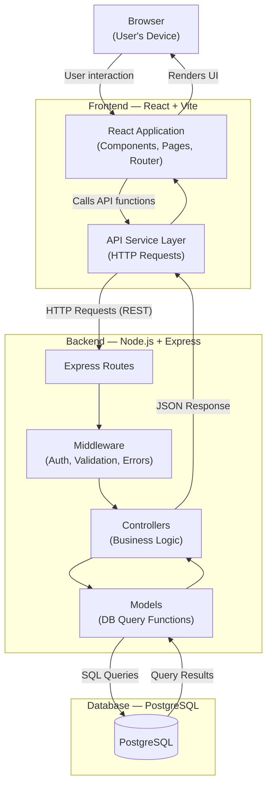

# System Architecture — Sidra (ስድራ)

> This document describes the planned technical architecture for the Sidra platform. All structures, layers, and configurations described here are **proposed** and have not yet been implemented. See also [Project Specification](./PROJECT_SPECIFICATION.md) and [UI/UX Design](./UI_UX_DESIGN.md).

---

## Table of Contents

1. [Architecture Overview](#architecture-overview)
2. [Technology Stack](#technology-stack)
3. [Layer Responsibilities](#layer-responsibilities)
4. [Architecture Diagram](#architecture-diagram)
5. [Proposed Folder Structure](#proposed-folder-structure)
6. [Environment Configuration](#environment-configuration)
7. [Authentication and Authorization](#authentication-and-authorization)
8. [Input Validation and Error Handling](#input-validation-and-error-handling)
9. [Database Migrations](#database-migrations)
10. [Testing Strategy](#testing-strategy)

---

## Architecture Overview

Sidra is planned as a full-stack web application following a standard client-server architecture. The frontend and backend are developed as separate applications that communicate over HTTP via a REST API.

- The **frontend** is a single-page application (SPA) built with React and served by Vite.
- The **backend** is a REST API built with Node.js and Express.js.
- The **database** is a PostgreSQL relational database.
- The backend is the only layer that communicates with the database directly.

This separation of concerns means the frontend never has direct access to the database. All data access goes through the API, where authentication and authorization are enforced.

---

## Technology Stack

| Layer | Technology | Version Target | Purpose |
|---|---|---|---|
| Database | PostgreSQL | Latest stable | Relational data storage |
| Backend runtime | Node.js | v18 LTS or later | JavaScript server-side runtime |
| Backend framework | Express.js | v4.x | HTTP routing and middleware |
| Frontend library | React.js | v18.x | Component-based UI |
| Frontend build tool | Vite | v5.x | Development server and production build |
| Styling | Tailwind CSS | v3.x | Utility-first CSS framework |
| Frontend routing | React Router | v6.x | Client-side navigation |
| Version control | Git + GitHub | — | Source control and collaboration |

Specific dependency versions will be pinned in `package.json` once scaffolding begins.

---

## Layer Responsibilities

### Frontend (React + Vite)

The frontend is responsible for everything the user sees and interacts with.

- Rendering the user interface using React components
- Managing client-side navigation with React Router
- Holding ephemeral UI state (form inputs, open/close toggles, loading flags)
- Making authenticated HTTP requests to the backend API
- Storing the authentication token (e.g., in memory or `localStorage`) and attaching it to outgoing requests
- Displaying loading, error, success, and empty states to the user
- Applying the visual design using Tailwind CSS utility classes

The frontend does **not** contain business logic, validate data for security purposes, or access the database.

### Backend (Node.js + Express.js)

The backend is responsible for all business logic, data access, and security enforcement.

- Defining and serving RESTful API routes
- Authenticating requests by verifying JWT tokens
- Enforcing role-based authorization on protected routes
- Validating and sanitizing all incoming request data
- Executing queries against the PostgreSQL database
- Returning structured JSON responses to the frontend
- Handling errors consistently and returning appropriate HTTP status codes

The backend is the single source of truth for data integrity. It never trusts input from the client without validation.

### Database (PostgreSQL)

The database is responsible for persistent, structured data storage.

- Storing all application data: users, courses, lessons, enrollments, progress records, professional profiles
- Enforcing data integrity through constraints (primary keys, foreign keys, unique constraints, not-null constraints)
- Supporting efficient queries through appropriate indexing

The database schema has not yet been designed. Table structures, relationships, and indices will be defined during the development phase.

### Authentication and Authorization Layer

This is a cross-cutting concern implemented within the backend.

- **Authentication** verifies who the user is (handled via JWT on every protected request).
- **Authorization** determines what the authenticated user is allowed to do (handled via role checks in middleware).

These are described in detail in the [Authentication and Authorization](#authentication-and-authorization) section below.

---

## Architecture Diagram

The diagram below illustrates how the main components of Sidra communicate. This represents the planned architecture.



---

## Proposed Folder Structure

The structure below is **proposed**. It will be established during the initial project scaffold phase and may evolve as development progresses.

```
sidra/
│
├── client/                          # React frontend (Vite)
│   ├── public/                      # Static files served as-is
│   ├── src/
│   │   ├── assets/                  # Images, icons, fonts
│   │   ├── components/              # Reusable UI components
│   │   │   ├── common/              # Generic components (Button, Card, Input, etc.)
│   │   │   ├── layout/              # Layout components (Navbar, Footer, PageWrapper)
│   │   │   └── [feature]/           # Feature-specific components
│   │   ├── pages/                   # Top-level page components (one per route)
│   │   ├── routes/                  # React Router configuration
│   │   ├── hooks/                   # Custom React hooks
│   │   ├── context/                 # React Context providers (e.g., AuthContext)
│   │   ├── services/                # Functions for making API calls
│   │   └── styles/                  # Global CSS, Tailwind base config
│   ├── index.html
│   ├── vite.config.js
│   ├── tailwind.config.js
│   └── package.json
│
├── server/                          # Node.js + Express backend
│   ├── config/
│   │   └── db.js                    # PostgreSQL connection setup
│   ├── controllers/                 # Request handlers — one per resource
│   ├── middleware/
│   │   ├── authMiddleware.js        # JWT verification
│   │   ├── roleMiddleware.js        # Role-based authorization checks
│   │   └── errorMiddleware.js       # Centralized error handler
│   ├── models/                      # Database query functions — one per resource
│   ├── routes/                      # Express route definitions — one file per resource
│   ├── validators/                  # Input validation schemas and functions
│   └── index.js                     # Server entry point
│
├── .env                             # Environment variables (never committed)
├── .gitignore
└── README.md
```

---

## Environment Configuration

All environment-specific configuration (database credentials, API secrets, ports) will be managed through environment variables stored in a `.env` file at the project root.

The `.env` file must never be committed to version control. It should be listed in `.gitignore`.

**Planned environment variables:**

```
# Server
PORT=                    # Port the Express server listens on (e.g., 5000)
NODE_ENV=                # Environment name: development | production | test

# Database
DATABASE_URL=            # Full PostgreSQL connection string

# Authentication
JWT_SECRET=              # Secret key used to sign JWT tokens (must be long and random)
JWT_EXPIRES_IN=          # Token expiry duration (e.g., 7d, 24h)
```

A `.env.example` file (with keys but no values) will be committed to the repository so that other developers know which variables are required.

---

## Authentication and Authorization

### Authentication

Sidra will use **JSON Web Tokens (JWT)** for stateless authentication.

**Planned flow:**
1. The user submits their email and password to the login endpoint.
2. The backend verifies the credentials against the database.
3. If valid, the backend signs a JWT containing the user's ID and role, then returns it to the client.
4. The frontend stores the token and attaches it to subsequent API requests in the `Authorization: Bearer <token>` header.
5. The backend verifies the token on every protected request using authentication middleware.

**Security considerations:**
- Passwords must be hashed with bcrypt (or equivalent) before storage. Plaintext passwords must never be stored.
- JWT signing secrets must be stored in environment variables and never hardcoded.
- Tokens should have a reasonable expiry duration (defined by `JWT_EXPIRES_IN`).
- If a token is invalid or expired, the backend returns a `401 Unauthorized` response.

### Authorization

Role-based authorization will be enforced at the route level in the backend.

**Planned roles:**
- `parent` — default role for registered users
- `admin` — elevated role for platform administrators

**Planned approach:**
- The JWT payload will include the user's role.
- A `roleMiddleware` function will check the decoded role against the required role for a given route.
- Routes requiring admin access will apply both `authMiddleware` (verify token) and `roleMiddleware` (check role).
- Authorization is always enforced server-side. Client-side role checks (e.g., hiding admin menu items) are UI conveniences only.

---

## Input Validation and Error Handling

### Input Validation

All data submitted by users must be validated on the backend before it is used, regardless of whether client-side validation is also present.

**Planned approach:**
- A dedicated `validators/` folder in the server will contain validation logic for each resource (e.g., user registration fields, course creation fields).
- A validation library (such as `joi`, `zod`, or Express Validator) will be selected during scaffolding.
- Validation will run as middleware before the controller handles the request.
- If validation fails, the middleware returns a `400 Bad Request` response with a clear description of which fields failed and why.

**Client-side validation** will also be implemented in the React frontend to provide immediate feedback before the form is submitted. This is a UX enhancement — it does not replace server-side validation.

### Error Handling

A centralized error-handling middleware will be defined in `server/middleware/errorMiddleware.js`. All unhandled errors in route handlers and controllers will be passed to this middleware using `next(error)`.

**Planned HTTP status codes:**

| Scenario | Status Code |
|---|---|
| Successful read | 200 OK |
| Successful creation | 201 Created |
| Successful delete or no content | 204 No Content |
| Validation error | 400 Bad Request |
| Invalid or missing token | 401 Unauthorized |
| Authenticated but not permitted | 403 Forbidden |
| Resource not found | 404 Not Found |
| Unexpected server error | 500 Internal Server Error |

Error responses will return a consistent JSON structure:

```json
{
  "error": {
    "message": "A human-readable description of the error",
    "status": 400
  }
}
```

Internal error details (stack traces, SQL errors) must never be exposed in API responses sent to the client.

---

## Database Migrations

The database schema has not yet been designed. Once table structures are defined, a migration strategy will be established.

**Planned approach:**
- Database migrations will be managed with a migration tool (such as `node-postgres` with manual SQL files, or a migration library like `db-migrate` or `Knex.js` migrations).
- Migration files will be version-controlled in the repository.
- Migrations will run in order and be tracked to avoid re-applying changes.
- A seed script for development data (test users, sample courses) will be created separately from production migrations.

---

## Testing Strategy

A testing strategy has not yet been finalized. The following describes the intended approach.

### Backend Testing

- **Unit tests** for individual functions — particularly validation logic, utility functions, and model query functions.
- **Integration tests** for API routes — testing that endpoints return the correct responses for valid and invalid inputs, and that authentication and authorization work correctly.
- A testing framework such as **Jest** or **Mocha + Chai** will be selected during scaffolding.
- A test database (separate from development) will be used for integration tests.

### Frontend Testing

- **Component tests** for individual React components using a library such as **React Testing Library**.
- Tests will focus on user behavior (what the component renders and how it responds to interaction) rather than implementation details.

### End-to-End Testing

- End-to-end testing (using a tool such as **Playwright** or **Cypress**) is a consideration for a later phase, once core features are stable.

> No tests have been written yet. Testing infrastructure will be established as part of the initial project scaffold.
